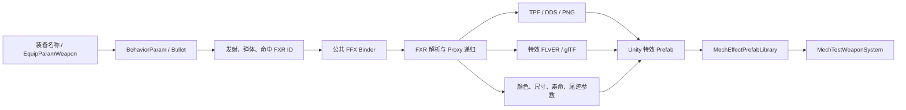

# AC6 原生武器特效导入管线

## 1. 目标

把测试场景中的枪口焰、弹体、尾迹和命中特效，从手工创建的 Unity 占位效果逐步替换为由 AC6 原始数据驱动的效果。

本管线保留原始资源的身份、引用关系和主要表现参数，但不声称已经复刻 AC6 的原生渲染器。FXR 中的着色、混合和部分节点语义仍需要在 Unity URP 中近似实现。

## 2. 数据来源

### 2.1 游戏解包文件

- 游戏根目录：`H:\ARMORED CORE VI FIRES OF RUBICON\Game`
- 公共特效包：`sfx\sfxbnd_commoneffects.ffxbnd.dcx`
- 提供 FXR、FFX 资源引用表、TPF 贴图和特效 FLVER 模型。
- 武器参数和弹体参数用于从装备 ID 追踪到 Bullet 与 FXR ID。

### 2.2 素材与研究目录

- 素材目录：`E:\UnityDev\Resources`
- 其中的解包样本、动作、模型与参数转储用于交叉验证，但原生特效重建以游戏解包文件为准。

### 2.3 社区资料与工具

- `@cccode/fxr`：解析 FXR 节点、字段和引用关系。
- `soulsmods/ac6-bhv-debug`：主要用于动作和行为图语义，不直接提供武器特效渲染结果。
- 项目中的社区装备资料表：用于核对游戏内名称、装备参数 ID、模型 ID 与武器类别。
- WitchyBND / SoulsFormats 相关工具链：用于 Binder、TPF、FLVER 与参数数据的提取和检查。

社区资料负责补足语义和格式知识，最终资源引用仍以本地游戏文件中的参数、FXR 和资源包为准。

## 3. 数据链



## 4. 实现组成

### 4.1 离线构建

- `Tools/BuildAC6NativeEffects.ps1`
  - 从公共 FFX Binder 中提取指定 FXR。
  - 递归解析 FXR Proxy 引用，避免生成空特效。
  - 收集 FXR 使用的贴图 ID 与模型 ID。
  - 从 TPF 提取 DDS，并通过 `texconv` 转成 Unity 可导入的 PNG。
  - 将 FXR 引用的 `sxxxxx.flver` 通过现有 FLVER 到 glTF 工具导出。
  - 对模型材质引用的共享 TPF 做二次提取，再重新导出带贴图的 GLB。
  - 写出 `native_effect_manifest.json`，记录来源和映射。

- `Tools/FxrTranslator/extract-fxr.mjs`
  - 解析 Billboard、Light、Tracer、Model、RichModel、QuadLine 等当前已知表现节点。
  - 输出 Unity 工厂可消费的中间 JSON。

- `Tools/DotNet/AC6PartToGltf/Program.cs`
  - 导出 FXR 引用的原始 FLVER 特效模型。
  - 处理 Binder 内带序号前缀的模型文件名与无前缀贴图名之间的匹配。

### 4.2 Unity 生成与运行时

- `Assets/_Project/Editor/AC6FxrEffectFactory.cs`
  - 根据中间 JSON 生成 ParticleSystem、TrailRenderer、LineRenderer、Light 或原始 GLB 模型实例。
  - 递归建立 Proxy 特效别名。
  - 根据 FLVER 导出报告中的 MTD 名称区分实体模型和加法特效承载网格；`NoLight_Add` 模型使用无光照、双面、透明加法材质，并关闭投影与深度写入。
  - 原始 GLB 不可用时才使用胶囊等占位几何。

- `Assets/_Project/Scripts/Mech/Runtime/MechTestWeaponSystem.cs`
  - 按当前装备映射读取原生发射、弹体和命中特效。
  - 找到原生弹体特效时关闭旧的手工弹丸 Renderer 与 TrailRenderer。
  - 找不到资源时保留占位效果作为故障降级。

- `MechEffectPrefabLibrary`
  - 运行时按 FXR ID 查询生成的 Prefab，避免武器逻辑硬编码具体 Prefab 路径。

## 5. 当前武器映射

| 槽位 | 装备 | EquipParam | BulletParam | 发射 FXR | 弹体 FXR | 命中 FXR |
| --- | --- | ---: | ---: | ---: | ---: | ---: |
| 右手 | MA-J-200 RANSETSU-RF | 10000000 | 10000000 | 6011100 | 6013101 | 6011101 |
| 左手 | DF-GR-07 GOU-CHEN | 15060000 | 10600000 | 6031100 | 6031101 | 待确认 |
| 左背 | BML-G1/P07VTC-12 | 35040000 | 30400000 | 6082100 | 6082101 | 待确认 |
| 右背 | BML-G2/P03MLT-06 | 30020000 | 30020000 | 6083100 | 6083101 | 待确认 |

其中 `6082100`、`6082101`、`6083100` 是代理特效，构建脚本会继续解析到 `6081100`、`6081101`、`6081000`。

## 6. 原始数据与 Unity 近似的边界

### 已直接使用原始数据

- 装备、Bullet 与 FXR ID。
- FXR Proxy 引用图。
- FXR 中的贴图编号、模型编号、尺寸、颜色、寿命和尾迹参数。
- 原始 TPF 贴图。
- 原始特效 FLVER 几何与材质贴图。
- `NoLight_Add` MTD 的透明加法混合语义。

### 仍为 Unity 近似实现

- AC6 原生 FXR Shader、混合模式、深度和排序规则。
- 除 `NoLight_Add` 之外尚未解析的 AC6 特效 MTD 规则。
- 部分复杂 Action/Draw 节点以及 GPU 粒子行为。
- 原游戏的屏幕空间畸变、后处理、光照耦合和材质参数语义。
- 尚未确认的榴弹与导弹命中/爆炸 FXR 映射。

因此当前目标是“资源身份和主要形态正确、可在游戏逻辑中工作”，下一阶段才是视觉逐项对齐。

## 7. 重建方式

在项目根目录运行：

```powershell
powershell.exe -NoProfile -ExecutionPolicy Bypass -File .\Tools\BuildAC6NativeEffects.ps1
```

然后在 Unity 中执行：

```text
Tools > ACunicombat > AC6 > Build Playable Player Scene
```

`Assets > Refresh` 只触发资源刷新，不会重建已经生成的 FXR Prefab。修改特效工厂、材质规则或中间 JSON 后，必须再次执行上述场景构建菜单。

离线中间文件位于 `Tools/LocalOut/AC6NativeSfx`。Unity 生成资源位于本地样例的 `Generated/Effects` 目录。

### 7.1 图集与发射数量

- FXR 的 Billboard 与加法模型允许通过 `columns`、`totalFrames`、`frameIndex` 和 `frameIndexOffset` 引用贴图图集中的单格。
- 转译器必须合并基础帧和帧偏移的曲线/随机范围，不能把整张图集当成一帧显示；否则 4×2 火焰图集会成为一整面火焰。
- Unity 粒子使用 Texture Sheet Animation 选择图集格；加法模型通过材质 UV scale/offset 选择单格。
- 单次粒子数量读取 FXR emitter 的 `perEmission`，不允许使用固定 Burst 数量。

## 8. 后续工作

1. 从 Weapon/Behavior/Bullet 参数和 TAE 事件继续确定榴弹与两类导弹的命中、爆炸和发射后状态 FXR。
2. 建立完整的装备 ID 到 FXR Profile 资产表，移除运行时的少量特例映射。
3. 增加更多 FXR Appearance 与 Action 节点解释器。
4. 对照原游戏截图与视频校准混合、颜色、尺寸、生命周期和模型朝向。
5. 将模拟目标接入雷达 `TrackSnapshot`，让导弹发射许可和制导不再直接读取 Transform。
